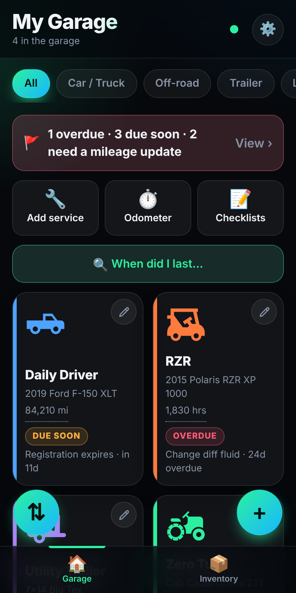
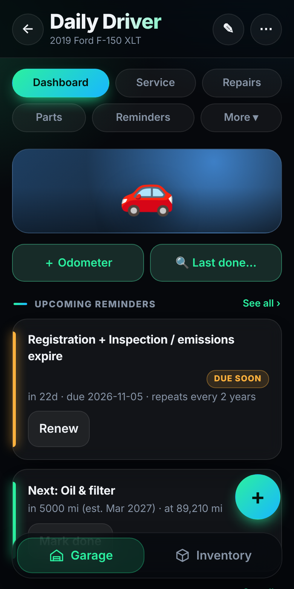
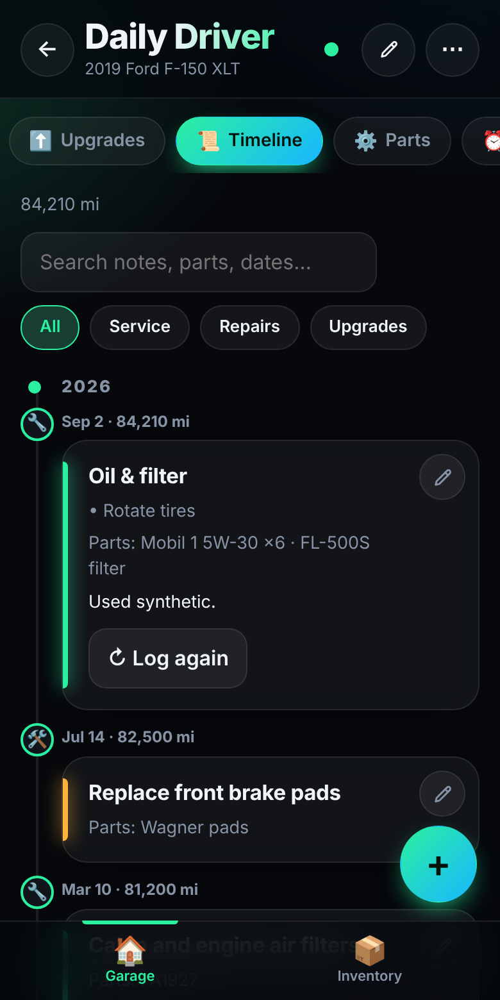
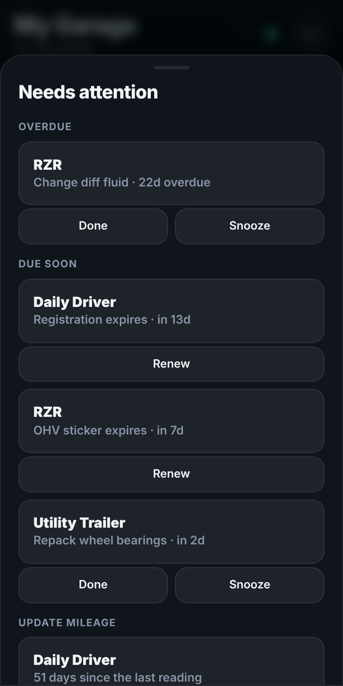
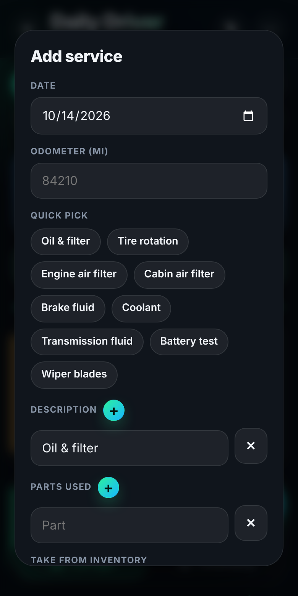
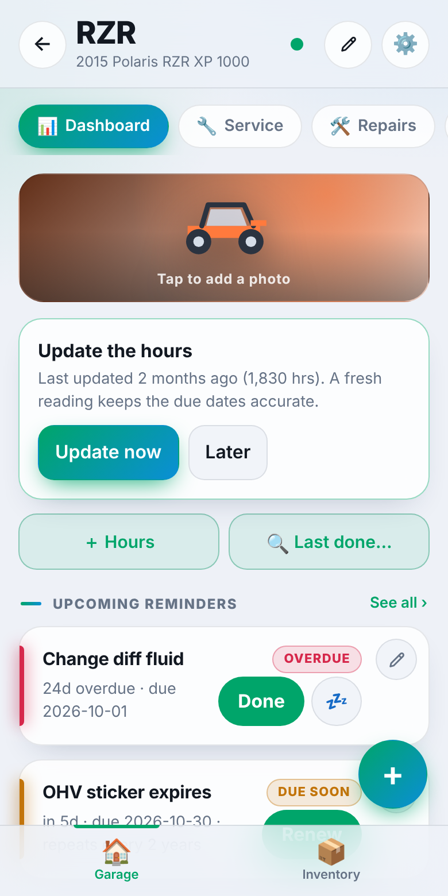

# Garage Log

A self-hosted maintenance log for the things in your garage: cars and trucks, UTVs, ATVs and dirt bikes, trailers, mowers and anything else with an engine. It runs as one small container on your own server (built for TrueNAS), keeps everything in one data folder, and has no cost tracking or accounts to manage. There is also an [Android app](https://github.com/Orangitaz/GarageLogger-Android) that works on its own or syncs with your server.

<p>



</p>
<p>



</p>

*Screenshots show sample data.*

## What it does
- **Garage and dashboards:** My Garage shows each piece of equipment as a colored tile with an icon you choose (car, pickup, ATV, UTV, dirt bike, Jeep, riding or push mower, camp, utility or car-hauler trailer and more) and a status, with quick tiles for adding a service, an odometer reading or a checklist. Each one has a dashboard with upcoming reminders and recent services and repairs. A **Needs attention** list shows what is overdue, due soon or needs a fresh odometer reading, with **Done** and **Snooze** right there.
- **Service, repair and upgrade records** with notes, photos, receipts, quick-pick services, who did the work, and parts used. Parts are either **bought for this job** or **taken from inventory** (which deducts the stock). A **Timeline** tab shows all three together.
- **Reminders** by date, miles or hours, with repeats (every 6 months, 1, 2 or 3 years, custom, or "every April"). Mileage reminders show an estimated date. Registration, the OHV sticker, warranty dates and your own dates (inspection, emissions, insurance) renew with one tap. After you add equipment, pick from a list of **common reminders** for that kind.
- **Parts and specs list** per piece of equipment, plus an **inventory** of oil, filters and supplies with low-stock badges and optional **where to buy** links. Several part numbers or brands per entry, with a camera button to scan barcodes and VINs.
- **Checklists** (before a ride, spring start-up, winterize) and **tire sets** with tread depth.
- **Fast logging:** **Log again** copies an earlier service, **quick jobs** remember parts and intervals, tap the odometer on a garage card to update it, swipe a reminder to finish or snooze it.
- **Finding things:** **When did I last…** searches every piece of equipment for a job or part, and each timeline has its own search and filters.
- **Reports and records:** documents (PDFs and photos), a printable **service history**, a **full history report** with photos, a one-record share page for a sale or a shop, **CSV export**, a link to **nhtsa.gov/recalls** with your VIN copied, **archive** for sold equipment, and **Undo** for deletes.
- **Alerts** to your phone through ntfy, Home Assistant or Gotify, a calendar feed, a status feed for Home Assistant dashboards, and a **view-only link** to share your garage.
- Works on phones and computers, installs like an app, keeps working offline, and merges edits from two devices. Dark and light themes, three text sizes, swipe-back navigation, built-in **Help**, and a **connection log** for troubleshooting sync. Optional password.

One image, one port, one data folder. No YAML needed.

## Part 1: Build the image (once, about 3 minutes, free)

1. Sign in at github.com and use your repository (`Orangitaz/GarageLogger`, private or public).
2. Upload everything in this folder to it. Keep the `.github` folder (drag the whole folder in).
3. Open the repo's **Actions** tab. The "Build and publish image" run starts by itself. If it doesn't,
   choose it on the left and click **Run workflow**. Wait for the green check.
4. Make the image public so TrueNAS can pull it without a login:
   your GitHub profile > **Packages** > `garagelogger` > **Package settings** > **Change visibility** > Public.
   (The image holds only the app, never your data, so public is fine.)
5. Your image name is `ghcr.io/orangitaz/garagelogger` (all lowercase), tag `latest`.

## Part 2: Install on TrueNAS (Community Edition)

1. **Make the data folder.** Storage > your pool > create a dataset, for example `apps/garage-log-data`.
2. **Apps > Discover Apps > Custom App.**
3. Fill in the form (labels can differ slightly between TrueNAS versions):
   - **Application name:** `garage-log`
   - **Image repository:** `ghcr.io/orangitaz/garagelogger`
   - **Image tag:** `latest`
   - **Run as user/group (if shown):** user `568`, group `568`
   - **Port:** container port `3000`, host (node) port `30500`, protocol TCP
   - **Storage:** add a **Host Path** volume. Host path = your dataset (for example `/mnt/YOURPOOL/apps/garage-log-data`),
     mount path = `/data`. If you see an **Automatic Permissions** checkbox, tick it.
   - Leave command and entrypoint empty. Environment variables are optional: `GARAGE_PASSWORD` turns on a password (see below).
4. Click **Install** and wait for the app to show **Running**.
5. Open `http://TRUENAS-IP:30500` in a browser. Tap the menu on your phone's browser and choose **Add to Home screen** (or **Install app**). It opens full screen with its own icon.

If the app stops right away, open its **Logs**. A "permission denied" on `/data` means the dataset isn't writable by
user 568: on the dataset's **Permissions** screen set the owner to `apps` (568) and save.

## Check it works
- The page loads at `http://TRUENAS-IP:30500`.
- Add a vehicle, then open the same address on another device: it shows there too.
- A file named `db.json` appears in your dataset folder. That one file is your whole garage (photos included).
  Snapshot or replicate the dataset to back it up.

## What's in the data folder
- `db.json` holds your records. `db.json.bak` is the version before the last save.
- `backups/` keeps one copy of `db.json` per day for the last 14 days. To roll back, stop the app, copy a file over `db.json`, and start it again.
- `docs/` holds attached documents (PDFs and photos).
- `photos/` holds every cover photo, record photo and receipt as its own file. Existing photos are moved here automatically the first time the new version starts, and a copy of the old `db.json` is kept in `backups/db-before-photo-move.json`.
- Two phones or tablets can edit at once. If one is out of date when it saves, the app merges the changes by item instead of overwriting the other device.

## Reminder alerts (optional)
In the app go to **⚙️ > Settings & data > Reminder alerts** and paste a web address the server can send to:
- ntfy: `https://ntfy.sh/your-private-topic` (choose "ntfy / text"), then subscribe to that topic in the ntfy app.
- Home Assistant: a webhook URL (choose "JSON webhook"). The message arrives as `title` and `message`.
- Gotify: `https://your-gotify/message?token=APP_TOKEN` (choose "JSON webhook").

Press **Send test message** to check it. The server then sends a message once a day at the time you pick, only when something has newly become due soon or overdue, and again weekly while it stays overdue. The server needs to be able to reach the address (a home server on your network works; ntfy.sh needs internet access).

## Repeating reminders, registration and the OHV sticker
- On any reminder, **Repeats** can be every 6 months, 1 year, 2 years, 3 years, or a custom number of months. Repeating reminders show **Renew** instead of Mark done. Renew marks it done and creates the next one, with the date filled in for you to adjust.
- Equipment has a **Registration expiration** (not for mowers) and offroad equipment has an **OHV sticker expiration**. Each has its own renewal interval, set to 2 years by default. They show on the dashboard with a **Renew** button and are included in the alerts.
- Reminders that come due by miles or hours show an estimated date, worked out from how fast your odometer or hour readings have been climbing (needs readings on at least two dates, two weeks or more apart).

## Parts from inventory, search and export
- In a service, repair or upgrade, **Take from inventory** subtracts what you used from your inventory. Editing or deleting the entry puts the difference back.
- **Last done** on the dashboard searches descriptions, parts and notes and shows when and at what reading it was last done.
- Deleting an entry or an inventory item shows **Undo** for a few seconds. Logging a reading lower than the last one asks you to confirm.
- On the garage screen the pencil lets you reorder your equipment with arrows. The **+** on an equipment's dashboard asks what to add.
- **Export records (CSV)** is under **⚙️ > Settings & data** (all equipment) and in each equipment's **More** menu (that one only).

## Extra dates, documents and archive
- Under an equipment's registration date, **+ Add another date** adds your own named dates (inspection, emissions, insurance). They stay hidden until you add one, repeat like registration, show on the dashboard with Renew, and go out in the alerts. Dates that fall on the same day (Oregon registration with inspection and emissions, say) show as one reminder, and Renew then asks for each new date.
- **More > Documents** attaches PDFs and photos (manuals, title copies, insurance cards) to a piece of equipment. The files live in the `docs/` folder of your data folder, so a dataset snapshot covers them. The backup file from Settings only lists them; it does not contain the files themselves.
- **Archive this equipment** (in the equipment's edit screen) takes it out of the garage, the alerts but keeps its history. Archived equipment is listed under **⚙️ > Settings & data > Archived equipment**, where you can print its history or restore it.

## Calendar, backups and shortcuts
- **Calendar link:** **⚙️ > Settings & data > Get calendar link** gives an address to subscribe to in Apple Calendar or an Android app such as ICSx⁵. It lists reminders and expiration dates that have a date. If you set a password, the link carries its own private key, so keep it to yourself. Google Calendar can't reach an address on your home network.
- **Server backups:** the server saves a copy of your data before the first change each day and keeps 14. They are listed under **Settings & data > Server backups**; download one and use **Restore from file**. Photos and documents stay in their folders and are not inside the copies.
- **Home-screen shortcuts:** long-press the installed app icon for **Add service** and **Inventory**.
- The dot in the title bar shows sync: green saved, orange saving, red offline (changes are kept on the phone and sent when it reconnects). Tap it for details.

## Home Assistant
`http://TRUENAS-IP:30500/api/summary` returns what is overdue or due soon, in total and per equipment:
`{"overdue":1,"due_soon":2,"total":3,"vehicles":[{"name":"Daily Driver","status":"due_soon","overdue":0,"due_soon":1,"items":[...]}]}`. `status` is `ok`, `due_soon` or `overdue`. Example for `configuration.yaml` (add `authentication: basic`, `username` and `password` under `rest:` if you set a password):

```yaml
rest:
  - resource: http://TRUENAS-IP:30500/api/summary
    scan_interval: 1800
    sensor:
      - name: "Garage overdue"
        value_template: "{{ value_json.overdue }}"
      - name: "Garage due soon"
        value_template: "{{ value_json.due_soon }}"
      - name: "Daily Driver service"
        value_template: "{{ (value_json.vehicles | selectattr('name','eq','Daily Driver') | map(attribute='status') | list)[0] | default('unknown') }}"
```

## Password (optional)
Set an environment variable `GARAGE_PASSWORD` on the app (TrueNAS: Edit > Environment Variables). The browser then asks for a password (any user name) before showing the app, your data or photos. Without it the app is open to anyone who can reach the port. The password is sent in a form that is only protected when you use the app through HTTPS (a reverse proxy) or a VPN, so it keeps casual visitors out on a home network but is not a substitute for those.

## Versions
Every release has a number (see `CHANGELOG.md` for what changed in each). The running version is shown at the bottom of **⚙️ > Settings & data** and at `/api/version`. The Docker image is tagged with it as well as `latest`, for example `ghcr.io/orangitaz/garagelogger:1.0.0`. To go back to an older version on TrueNAS, change the image tag from `latest` to that number and save. Your data stays as it is. To release a new version, raise the number in the `VERSION` file, add a line to `CHANGELOG.md`, and push to `main`.

## Updating
Change the code, commit it, and let GitHub rebuild. Then on TrueNAS: Apps > garage-log > **Edit**, re-save
(or use the app's update/redeploy action) so it pulls the newest `latest` image. Your data stays in the dataset.

## Notes
- No login unless you set `GARAGE_PASSWORD`. Keep it on your home network or behind a VPN or reverse proxy.
- Change `30500` to any free port; the container always listens on 3000.
- No GitHub? Build on any PC with Docker: `docker build -t YOURUSER/garage-log .` then
  `docker push YOURUSER/garage-log` (Docker Hub), and use `YOURUSER/garage-log` as the image name.

## Android app

Optional. The web app also installs from Chrome (⋮ > Install app). For a real Android app, see the separate repo [GarageLogger-Android](https://github.com/Orangitaz/garagelogger-android). It builds the same app into an APK that **works on its own, with no server**: your data stays on the phone. If you also run Garage Log on a server, enter its address in **Settings & data > Server** and the phone syncs with it (and with your other devices).

Without a server the phone can't send reminder alerts, store documents or offer a calendar link, because those run on the server.

## Credits
Equipment icons come from open icon sets: [Material Design Icons](https://pictogrammers.com/library/mdi/) by Pictogrammers (Apache 2.0), [Font Awesome Free](https://fontawesome.com) (the motorcycle and utility trailer icons; CC BY 4.0), and the Jeep icon by [Delapouite](https://delapouite.com) from [game-icons.net](https://game-icons.net) (CC BY 3.0). The car hauler is a car icon placed on a trailer.
